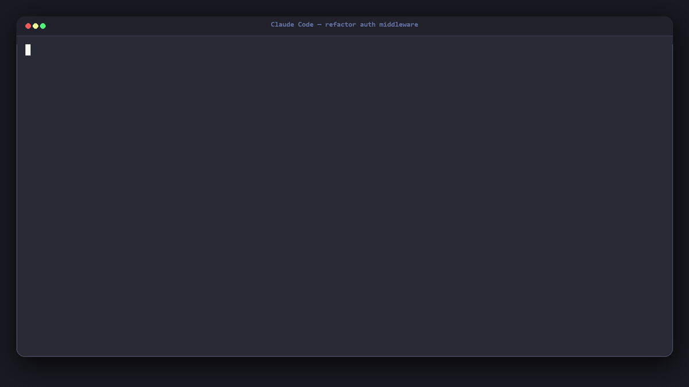
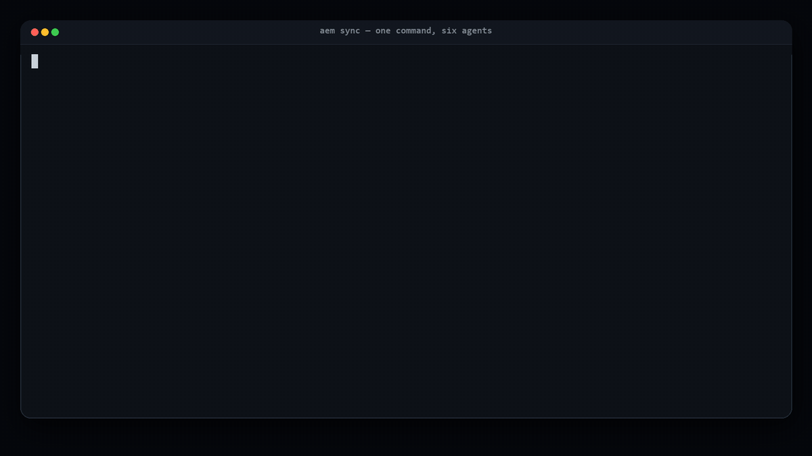
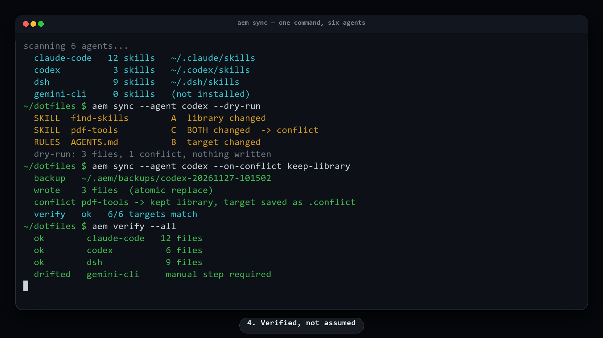

# demo-reel

**Turn a text file into a pixel-perfect terminal demo video.** No screen recording. No headless browser. No ttyd. Just Python and `ffmpeg`.

[](https://github.com/Jack91124/demo-reel/actions/workflows/ci.yml)
[](https://github.com/Jack91124/demo-reel)
[](https://github.com/Jack91124/demo-reel)
[](LICENSE)

**Landing page:** <https://jack91124.github.io/demo-reel/>

```bash
# until the PyPI release lands:
pip install "git+https://github.com/Jack91124/demo-reel"
demoreel render demos/claude-session.toml -o demo.mp4
```



*(The GIF above is the output of `demoreel render demos/claude-session.toml` — generated frame by frame, not captured from a screen.)*

---

## Why this exists

Every README in the AI-tooling world has the same problem: **you cannot show the thing working without recording your desktop.** So people either record a shaky GIF with their wallpaper and notifications in it, or they don't show anything.

The existing tools have all gone stale:

| Tool | Stars | Last release | Problem |
|---|---|---|---|
| [charmbracelet/vhs](https://github.com/charmbracelet/vhs) | 21k | active | needs headless Chrome **and** ttyd; Windows support is fragile; cannot render an **agent conversation** |
| [asciinema](https://asciinema.org) | 18k | active | records a real shell session — non-deterministic, needs interaction |
| [terminalizer](https://github.com/faressoft/terminalizer) | 16k | 2024-08 | unmaintained |
| [svg-term-cli](https://github.com/marionebl/svg-term-cli) | 4k | 2024-05 | unmaintained |
| [termtosvg](https://github.com/nbedos/termtosvg) | 9k | 2020 | unmaintained |

And **none of them can show an AI agent session.** In 2026 that is the thing everybody wants to show: a Claude Code run, a Codex session, an agent fixing a bug. Those aren't shell commands — they are `user` / `assistant` / `tool call` turns.

demo-reel treats a demo the way you treat code: **a text file you commit, review, diff, and re-render.**

```toml
[[steps]]
type = "user"
label = "you"
text = "auth middleware accepts expired tokens, fix it"
caption = "Real agent work, recorded as a spec — not a screen cast"

[[steps]]
type = "tool"
label = "Read"
call = "src/auth/middleware.ts"
lines = ["1  export async function verify(req: Request) {", "3    return decode(t)   // no exp check"]

[[steps]]
type = "assistant"
label = "claude"
text = "The decoder ignores exp. I will reject tokens whose exp is in the past."
```

Change a line, re-render, commit. Your demo is now reviewable in a pull request.

---

## Install

```bash
pip install "git+https://github.com/Jack91124/demo-reel"   # 0.1.0, pre-PyPI
# once published:  pip install demo-reel
```

Requirements: **Python 3.11+**, **ffmpeg** on `PATH` (or pass `--ffmpeg`), **Pillow** (installed automatically).

```bash
# macOS          brew install ffmpeg
# Ubuntu/Debian  sudo apt install ffmpeg
# Windows        winget install Gyan.FFmpeg
```

Verify: `demoreel --help`

---

## 60-second workflow

```bash
# 1. render a demo from the included example
demoreel render demos/aem.toml -o demo.mp4

# 2. see the timeline before spending CPU
demoreel inspect demos/aem.toml

# 3. grab a single frame for the README thumbnail
demoreel still demos/aem.toml -o poster.png --at 6.5

# 4. GIF for the README (smaller, 1200px wide, palette-optimised)
demoreel render demos/aem.toml -o demo.gif --gif
```



---

## The feature nobody else has: render a real agent session

Point it at a session log you already have, and it writes the TOML for you — then renders it.

```bash
demoreel from-session ~/.claude/projects/-Users-me-api/3f2a....jsonl \
  -o demos/that-bugfix.toml --render demos/that-bugfix.mp4
```

**Supported formats (auto-detected):**

- **Claude Code** — `~/.claude/projects/<munged-cwd>/<uuid>.jsonl`
- **Codex** — `~/.codex/archived_sessions/rollout-*.jsonl`

What it does to the transcript, so the result is watchable rather than a wall of JSON:

| Problem in a raw log | What demo-reel does |
|---|---|
| ANSI escape codes, CRLF, control chars | stripped |
| `<system-reminder>` / `<app-context>` blocks | dropped |
| Multi-line prose | flattened to one readable line |
| Markdown emphasis, inline code | removed |
| Mojibake (replacement-char runs) | dropped instead of drawn as boxes |
| 200-line tool outputs | clipped to N lines with ellipsis |
| Tool call → result pairing | reconstructed via `tool_use_id` / `call_id` |
| Failed tool calls | rendered in red |
| Sidechain / meta / developer preamble | skipped |

Also handles **Chinese, Japanese and Korean text at the correct width** — CJK glyphs occupy two terminal cells, and the renderer measures them with real font metrics (`east_asian_width` + per-script font fallback), so nothing overlaps.

```bash
demoreel from-session session.jsonl -o out.toml \
  --theme nord --max-steps 12 --no-tools --line-width 80
```

> DSH (`session.v4.jsonl.zstd`) logs are **zstd-compressed**; demo-reel ships no decoder. Decompress first, then convert the plain `.jsonl`.

---

## Script reference

### `[meta]`

| Key | Default | Meaning |
|---|---|---|
| `title` | `""` | window title bar text |
| `width` / `height` | `1600` / `900` | output resolution |
| `font_size` | `24` | cell height is derived from real font metrics |
| `fps` | `30` | frame rate |
| `chars_per_second` | `30` | typing speed |
| `output_delay` | `0.055` | delay between output lines (s) |
| `gap_after_step` | `0.55` | pause between steps (s) |
| `lead_in` / `tail` | `0.55` / `1.1` | silence at the start / end (s) |
| `prompt` | `"~ $ "` | shell prompt prefix |
| `prompt_style` | `"green"` | colour name from the theme |
| `theme` | `"github-dark"` | see below |

### `[[steps]]` — terminal mode

| `type` | Keys |
|---|---|
| `cmd` | `text`, optional `prompt`, `style`, `enter` |
| `out` | `lines` (array), `style`, `delay` |
| `clear` | — |
| `pause` | `seconds` |
| `banner` | `text`, `style` |

### `[[steps]]` — agent mode

| `type` | Keys |
|---|---|
| `user` | `text`, `label` (default `you`) |
| `assistant` | `text`, `label` (default `agent`) |
| `tool` | `label` (tool name), `call` (arg summary), `lines`, `out_style` |

Any step may carry `caption` and `caption_hold` (seconds) for a bottom-of-frame subtitle pill.

### Themes

`github-dark` · `dracula` · `nord` · `light` · `midnight` · `solarized`



Each theme is a flat dict of 19 colour keys — adding your own is a 20-line pull request (`demoreel/themes.py`).

---

## CLI

```
demoreel render  <spec.toml> -o <out.mp4|gif> [--gif] [--fps N] [--crf N] [--quiet]
demoreel still   <spec.toml> -o <out.png> [--at SECONDS]
demoreel inspect <spec.toml>
demoreel from-session <session.jsonl> -o <out.toml> [--render out.mp4] [--gif]
```

`render` streams raw RGB24 frames straight into `ffmpeg` over a pipe — **no frames are written to disk**, so a 13-second 1080p demo costs one subprocess and about as much wall time as its duration. MP4 uses `libx264 -preset medium -crf 18 -pix_fmt yuv420p -movflags +faststart` (plays everywhere); GIF uses a two-pass palette (`palettegen` → `paletteuse` with bayer dithering).

---

## Design notes

**Why not a headless browser?** VHS renders a real xterm.js in Chrome. That buys perfect terminal emulation, and costs a 300 MB dependency, a fragile Windows story, and a hard wall at "this is a shell, not a conversation." demo-reel draws a character grid with Pillow: `cell_w` comes from `font.getlength("M")`, `cell_h` from the font bounding box, text is drawn per run with a shared baseline. It's ~700 lines, it has no browser, and it renders agent turns natively.

**Determinism.** Same TOML → byte-identical frames. No timing jitter, no font reflow surprises, no "oops my notification popped up."

**Honest limitation.** This is a terminal *renderer*, not an emulator. It does not run your program. If your demo depends on real ANSI art, cursor addressing, or a TUI redrawing itself, use VHS. If your demo is "here is a command, here is its output" or "here is an agent session," demo-reel will do it in a tenth of the setup.

---

## Development

```bash
git clone https://github.com/Jack91124/demo-reel
cd demo-reel
pip install -e ".[dev]"
python -m pytest tests -q                   # 39 tests, ~0.4 s
```

Tests synthesise Claude/Codex session fixtures in temp dirs — they never read your real agent history and never write outside `tmpdir`.

Layout:

```
demoreel/
  term.py         character grid, CJK width handling, window chrome, captions
  script.py       TOML -> timed event stream
  fromsession.py  Claude Code / Codex JSONL -> Msg[] -> TOML
  encode.py       ffmpeg pipe: MP4 and GIF
  fonts.py        cross-platform font discovery (Win/macOS/Linux, graceful fallback)
  themes.py       colour palettes
  cli.py          render / still / inspect / from-session
demos/            example scripts
tests/            unittest suite
```

Runs on Windows, macOS and Linux with no OS-specific code paths beyond font discovery (which
degrades to Pillow's built-in bitmap face rather than crashing). Contributions most wanted: more
session formats (Gemini CLI, Cursor, DSH), a `--poster` auto-thumbnail, and user-supplied themes.

## License

MIT
